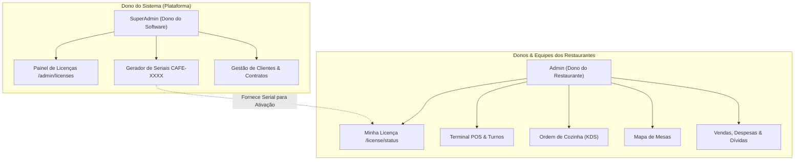
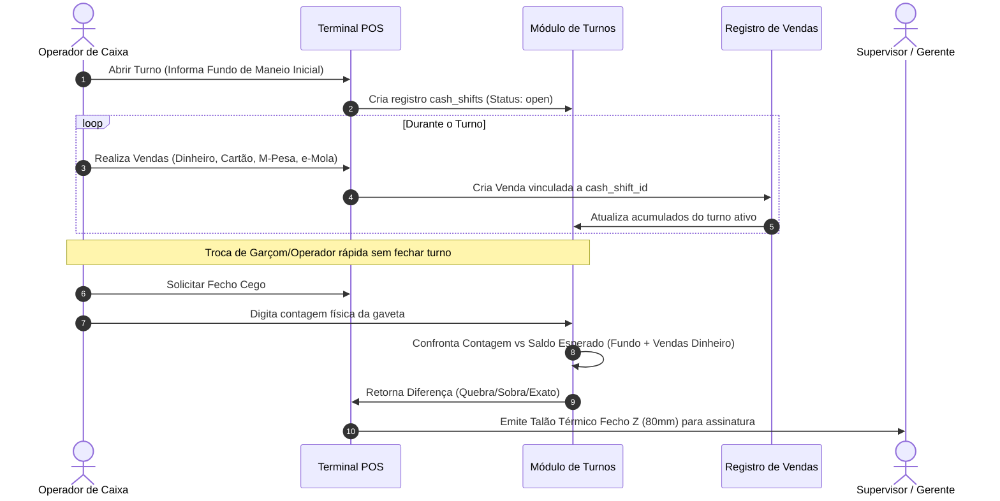

# Arquitetura, Licenciamento & Roteiro de Produção - RestPOS Suite

> [!NOTE]
> Este documento consolida a arquitetura completa do **RestPOS**, a segregação estrita entre o Dono da Plataforma (`superadmin`) e os Donos de Restaurantes (`admin`), o sistema de turnos com fecho cego, o sistema de licenciamento por serial criptografado, os instaladores desktop (Linux/Windows) e os scripts de deploy na nuvem.

---

## 1. Segregação de Papéis e Permissões



### Matriz de Acesso:
- **`superadmin`**:
  - Exclusivo: `/admin/licenses` (Emissão, geração de seriais, prorrogação de dias, suspensão).
  - Acesso irrestrito a todos os módulos para suporte e configuração.
- **`admin` (Dono do Restaurante)**:
  - Não tem acesso à emissão de licenças (`/admin/licenses` bloqueado por middleware).
  - Acesso a `/license/status` para consultar a validade da sua licença e inserir a chave de renovação.
  - Acesso total ao restaurante: Cardápio, POS, Cozinha, Garçons, Clientes, Relatórios e Configurações locais.
- **`manager` / `waiter` / `cashier`**:
  - Operação de caixa, abertura e fecho cego de turno, emissão de pedidos e mesas.

---

## 2. Sistema de Licenciamento & Seriais

> [!TIP]
> A chave de licença é gerada com o formato `CAFE-XXXX-XXXX-XXXX-XXXX` e validada por hash SHA-256 e assinatura local de hardware (*fingerprint*).

```
Exemplo de Chave Serial:
CAFE-8B4F-29AE-7CD1-049A
```

### Características Técnicas:
- **Planos Suportados**: `trial` (15 dias), `monthly` (30 dias), `quarterly` (90 dias), `annual` (365 dias), `lifetime` (Vitalícia).
- **Parâmetros Operacionais**: Limite máximo de mesas e limite máximo de utilizadores simultâneos.
- **Controle de Estado**: `active`, `expired`, `suspended`, `revoked`.
- **Validação Offline**: O *fingerprint* local é derivado do hostname e hardware do servidor local, garantindo que instalações locais sem internet continuem operando regularmente.

---

## 3. Sistema de Turnos de Caixa & Fecho Z



---

## 4. PWA Mobile & Aplicativos Desktop

```
Instalação RestPOS:
├── public/manifest.json     (Configuração PWA com ícones e atalhos rápidos)
├── public/sw.js             (Service Worker para cache estático e offline shell)
├── install-linux.sh         (Instalador desktop Linux - Chrome/Chromium Kiosk com --kiosk-printing)
├── install-windows.bat      (Instalador desktop Windows - Atalho Nativo Edge/Chrome)
└── uninstall-linux.sh       (Desinstalador de atalhos e serviços)
```

### Recursos dos Instaladores:
1. **Modo App Nativo**: Abre o POS em janela própria limpa, sem abas, barra de URL ou menus do navegador.
2. **Impressão Térmica Automática**: Suporte a `--kiosk-printing` para envio direto para impressoras de talão sem abrir a caixa de diálogo do sistema operacional.
3. **Servidor Local Autónomo**: Instalação do PHP local com serviço em segundo plano para computadores de caixa que operam desconectados.

---

## 5. Roteiro de Deploy em Nuvem & Multi-Tenant

### Servidor de Produção:
- **IP**: `146.235.224.99`
- **Diretório**: `/var/www/html/RestPOS`
- **Branch**: `v1.3`
- **Nginx Config**: `nginx/restpos.conf`

```bash
# Executar deploy automatizado:
./deploy.sh
```

### Arquitetura de Sincronização Nuvem / Restaurantes Locais:
- **Nuvem Central**: Hospeda o banco de dados principal, controle de licenças e painel central do SuperAdmin.
- **Nós Locais dos Restaurantes**: Instalações nos computadores locais para tolerância a falhas de internet.
- **Sincronização via API Implementada (`v1.3`)**:
  1. *Comando de Push Assíncrono*: `php artisan restpos:sync-push` com suporte a execução periódica via cron ou agendador.
  2. *Ingestão Idempotente*: Endpoint `/api/sync/ingest` autenticado por Token/Serial com mapeamento automático de Tenant via `offline_id`.
  3. *Verificação Central de Licença*: Endpoint `/api/sync/verify-license` para ativação remota e heartbeat.
  4. *Disparo Manual na UI*: Botão "Sincronizar Agora com a Nuvem" no menu Minha Licença (`/license/status`).
  5. *Monitoramento pelo Dono*: Painel SaaS com indicador em tempo real da última sincronização de cada restaurante.
  6. *Guia Completo*: Disponível em `docs/CLOUD_SYNC_GUIDE.md`.

---

## 6. Correções v1.3.1 (Edição de Produtos, Tradução e Impressão de Logotipo)

- **Edição de Produtos (`/products`)**:
  - Corrigido endpoint de busca e submissão na interface Alpine.js (`url('/products')` em vez de `/products` estático), garantindo compatibilidade com subdiretórios (`/RestPOS`).
  - Preenchimento do preço anterior: produtos legados com coluna `selling_price` nula agora preenchem automaticamente a partir de `price`.
  - Migração de banco de dados (`2026_10_26_193000_sync_product_selling_prices.php`) e accessors em `Product.php` garantindo consistência bidirecional entre `price` e `selling_price`.
  - Correção das chamadas assíncronas de atualização de estoque e exclusão (`url('/products/{id}/stock')` e `url('/products/{id}')`).

- **Traduções do Sistema (`messages.php`)**:
  - Adicionadas 16 chaves em falta (`edit`, `save`, `role`, `view`, `last_access`, `professional_management`, `amount`, `date`, `confirm_delete`, `id`, `quantity`, `item`, `price`, `no_items_found`, `search`, `name`) em português (`lang/pt/messages.php`) e inglês (`lang/en/messages.php`).
  - Resolvido o problema em que títulos e botões exibiam a string literal `messages.edit`.

- **Logotipo e Identificação nos Recibos Térmicos**:
  - Criada função auxiliar `get_receipt_logo_data()` em `app/Helpers/helpers.php` que converte o logotipo em Data URI (base64) síncrono, eliminando falhas de carregamento em impressão térmica, erros 404 de maiúsculas/minúsculas (`Logo.png` vs `logo.png`) e problemas de caminho relativo em subpastas.
  - Atualizados os recibos de venda (`sales/receipt.blade.php`), PDV (`pos/receipt.blade.php`), pedidos (`orders/receipt.blade.php`) e fecho de caixa (`cash-shifts/receipt.blade.php`) para carregar o logotipo de forma garantida e exibir dinamicamente o nome do estabelecimento ("Café Lu & Yoshi") e seus dados fiscais.

- **Criação e Gestão de Usuários (`/users`)**:
  - Corrigida a validação de criação de usuário no `UserController`: o campo `status` agora é opcional e assume o padrão `active`, permitindo criar usuários diretamente pelo modal sem bloqueio de validação silenciosa.
  - Tamanho mínimo de senha ajustado para 4 caracteres (compatível com PINs/senhas rápidas de caixa e garçom).
  - Vinculação automática do novo usuário ao `tenant_id` do administrador autenticado, mantendo o isolamento multi-tenant.
  - Adicionado campo de seleção de Status no modal de criação/edição e reabertura automática do modal com banner de erros detalhado caso ocorra qualquer erro de validação.
  - Correção da rota de submissão de edição com prefixo base (`url('/users')`).
  - Toasts globais configurados no layout principal para exibir erros de validação da sessão.

---

## 7. Melhorias Visuais & CMS de Pedidos Online (v1.3.2)

- **Redesign do Catálogo de Produtos (`/products`)**:
  - Implementado alternador entre **Vista em Grelha (Grid)** e **Vista em Lista (Tabela)** com persistência automática em `localStorage`.
  - Restaurados e destacados os botões de ação (**Editar**, **Ajustar Estoque** e **Excluir**) para perfis `admin`, `superadmin` e `manager`.

- **Botões de Ação de Alto Contraste no Carrinho do POS (`/pos`)**:
  - Removido o fundo cinza de baixo contraste (`bg-gray-200/70` e `disabled:opacity-30`) que ofuscava os botões de ação no carrinho.
  - Aplicadas cores vibrantes e nítidas para cada ação:
    - **Guardar**: Âmbar sólido (`bg-amber-500 hover:bg-amber-600 text-white`).
    - **Recuperar**: Azul sólido (`bg-blue-600 hover:bg-blue-700 text-white`).
    - **Dívida**: Vermelho/Rosa sólido (`bg-rose-600 hover:bg-rose-700 text-white`).
    - **Concluir Venda**: Verde Esmeralda sólido (`bg-emerald-600 hover:bg-emerald-700 text-white`).

- **Nova Página Pública de Boas-Vindas & Pedidos Online (`/`) + CMS Administrativo (`/website`)**:
  - **Hero Banner Slider Interativo**: Carrossel rotativo com transição suave, setas de navegação, indicadores e botões de chamada para ação ("Explorar Cardápio", "Encomendar Para Levar").
  - **Duplo Modo de Exibição do Cardápio (inspirado em menus gastronómicos modernos)**:
    - *Galeria com Fotos*: Cartões visuais ricos com fotografia culinária e contador rápido.
    - *Menu Clássico de Restaurante*: Layout em duas colunas com miniaturas, linha pontilhada clássica (*dotted leader*) ligando o prato ao preço e botão rápido de pedido.
  - **Imagens Culinárias Inteligentes**: Exibe a foto enviada pelo restaurante ou seleciona automaticamente fotografias gastronómicas de alta resolução de acordo com a categoria/nome do prato (cafetaria, grelhados, mariscos, bebidas, pastelaria, etc.).
  - **CMS na Área Administrativa (`/website`)**:
    - Gestão completa dos slides do banner (adicionar, ativar/desativar, ordenar e remover slides).
    - Gestão de textos e secções da página ("Sobre Nós", imagem institucional, barra de anúncio promocional, horário de funcionamento, WhatsApp, Instagram e Facebook).
  - **Pedidos Online & Na Mesa**: Suporte completo a encomendas para levar (*Takeaway*) e consumo na mesa via QR Code, com acompanhamento ao vivo em 4 etapas (`url('/order-status/{id}')`).
