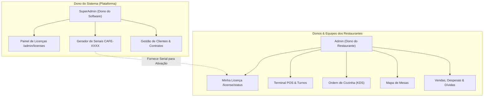
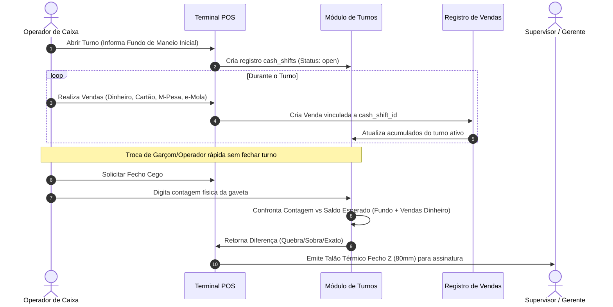

# Arquitetura, Licenciamento & Roteiro de Produção - RestPOS Suite

> [!NOTE]
> Este documento consolida a arquitetura completa do **RestPOS**, a segregação estrita entre o Dono da Plataforma (`superadmin`) e os Donos de Restaurantes (`admin`), o sistema de turnos com fecho cego, o sistema de licenciamento por serial criptografado, os instaladores desktop (Linux/Windows) e os scripts de deploy na nuvem.

---

## 1. Segregação de Papéis e Permissões



### Matriz de Acesso:
- **`superadmin`**:
  - Exclusivo: `/admin/licenses` (Emissão, geração de seriais, prorrogação de dias, suspensão).
  - Acesso irrestrito a todos os módulos para suporte e configuração.
- **`admin` (Dono do Restaurante)**:
  - Não tem acesso à emissão de licenças (`/admin/licenses` bloqueado por middleware).
  - Acesso a `/license/status` para consultar a validade da sua licença e inserir a chave de renovação.
  - Acesso total ao restaurante: Cardápio, POS, Cozinha, Garçons, Clientes, Relatórios e Configurações locais.
- **`manager` / `waiter` / `cashier`**:
  - Operação de caixa, abertura e fecho cego de turno, emissão de pedidos e mesas.

---

## 2. Sistema de Licenciamento & Seriais

> [!TIP]
> A chave de licença é gerada com o formato `CAFE-XXXX-XXXX-XXXX-XXXX` e validada por hash SHA-256 e assinatura local de hardware (*fingerprint*).

```
Exemplo de Chave Serial:
CAFE-8B4F-29AE-7CD1-049A
```

### Características Técnicas:
- **Planos Suportados**: `trial` (15 dias), `monthly` (30 dias), `quarterly` (90 dias), `annual` (365 dias), `lifetime` (Vitalícia).
- **Parâmetros Operacionais**: Limite máximo de mesas e limite máximo de utilizadores simultâneos.
- **Controle de Estado**: `active`, `expired`, `suspended`, `revoked`.
- **Validação Offline**: O *fingerprint* local é derivado do hostname e hardware do servidor local, garantindo que instalações locais sem internet continuem operando regularmente.

---

## 3. Sistema de Turnos de Caixa & Fecho Z



---

## 4. PWA Mobile & Aplicativos Desktop

```
Instalação RestPOS:
├── public/manifest.json     (Configuração PWA com ícones e atalhos rápidos)
├── public/sw.js             (Service Worker para cache estático e offline shell)
├── install-linux.sh         (Instalador desktop Linux - Chrome/Chromium Kiosk com --kiosk-printing)
├── install-windows.bat      (Instalador desktop Windows - Atalho Nativo Edge/Chrome)
└── uninstall-linux.sh       (Desinstalador de atalhos e serviços)
```

### Recursos dos Instaladores:
1. **Modo App Nativo**: Abre o POS em janela própria limpa, sem abas, barra de URL ou menus do navegador.
2. **Impressão Térmica Automática**: Suporte a `--kiosk-printing` para envio direto para impressoras de talão sem abrir a caixa de diálogo do sistema operacional.
3. **Servidor Local Autónomo**: Instalação do PHP local com serviço em segundo plano para computadores de caixa que operam desconectados.

---

## 5. Roteiro de Deploy em Nuvem & Multi-Tenant

### Servidor de Produção:
- **IP**: `146.235.224.99`
- **Diretório**: `/var/www/html/RestPOS`
- **Branch**: `v1.3`
- **Nginx Config**: `nginx/restpos.conf`

```bash
# Executar deploy automatizado:
./deploy.sh
```

### Arquitetura de Sincronização Nuvem / Restaurantes Locais:
- **Nuvem Central**: Hospeda o banco de dados principal, controle de licenças e painel central do SuperAdmin.
- **Nós Locais dos Restaurantes**: Instalações nos computadores locais para tolerância a falhas de internet.
- **Sincronização via API**:
  1. *Pull de Cardápio*: O nó local baixa produtos e categorias atualizados da nuvem.
  2. *Push de Fecho Z*: Ao fechar o turno, o nó local envia o balanço diário e as vendas para a nuvem.
  3. *Verificação de Licença*: Validação de dias restantes com tolerância de até 7 dias offline.
